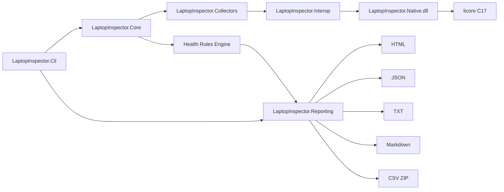

# Архитектура LaptopInspector

LaptopInspector строится как гибридное приложение: управляемый оркестратор .NET запускает независимые сборщики, а нативные библиотеки предоставляют C ABI для низкоуровневых источников Windows. Все сборщики выполняются в режиме read-only; запись допускается только в каталог отчётов и во временные файлы будущих бенчмарков.

## Основные контракты

- `ICollector` — автономный read-only модуль сбора данных с зависимостями, таймаутом и признаком необходимости прав администратора.
- `CollectionScheduler` — планировщик с топологическим порядком, параллельным выполнением уровней графа и изоляцией ошибок.
- `CollectorResult` — единый результат сборщика: статус, длительность, JSON-данные, находки, ошибки и причина пропуска.
- `InspectionReport` — каноническая модель отчёта для всех форматов вывода.
- `IReportWriter` — расширяемый генератор форматов отчёта.

## Поток выполнения

1. CLI разбирает команду и параметры.
2. DI-контейнер создаёт планировщик, сборщики и генераторы отчётов.
3. Планировщик запускает сборщики с индивидуальными таймаутами и общим `CancellationToken`.
4. Фабрика отчёта объединяет результаты, вызывает Health Rules Engine, строит оценки и формирует метаданные.
5. Генераторы сохраняют HTML/JSON/TXT/Markdown/CSV ZIP в каталог вывода.

## Политика приватности

Режим `--anonymize` заменяет имена пользователей, имена компьютеров, серийные номера и будущие MAC/SSID на детерминированные хэши в пределах одного отчёта. Wi-Fi пароли, BitLocker recovery keys, cookies, браузерная история и пользовательские файлы не собираются.

## C17-ядро `licore`

`licore` не зависит от WinAPI и компилируется как статическая библиотека. Все публичные функции принимают бинарный буфер и возвращают UTF-8 JSON через `li_json_output`; память освобождается `li_json_output_free` или `li_core_free`. Парсеры проверяют границы перед чтением и считают данные прошивки недоверенными.

Реализованные входы Этапа 2:

- `li_smbios_to_json` — RawSMBIOSData или DMI-table, структуры 0–46/OEM, strings, raw hex;
- `li_edid_to_json` — EDID base block, CTA-861 extension, DisplayID generic blocks;
- `li_acpi_tables_to_json` — одна или несколько ACPI-таблиц подряд, checksum и детали ключевых сигнатур;
- `li_cpuid_to_json` — выполнение CPUID на x86/x64 с декодированием флагов, кэшей и топологии;
- `li_smart_ata_to_json` — 512-байтный ATA S.M.A.R.T. attribute block;
- `li_nvme_health_to_json` — 512-байтный NVMe SMART/Health Information Log 0x02;
- `li_core_crc32`, `li_core_sha256_hex` — хэширование и контрольные суммы.

Нативные тесты используют фикстуры из `tests/fixtures/*.bin` и запускаются через `ctest` при включённом `LI_BUILD_NATIVE_TESTS`.

## C++20-слой `LaptopInspector.Native`

Нативная DLL экспортирует плоский C ABI и не пропускает исключения через границу модуля. Все функции возвращают `int32_t` status и UTF-8 JSON через `char**`, память освобождается `li_free`. На Windows используются только read-only API и handles с RAII-обёртками; на других ОС функции возвращают JSON со статусом `unsupported`.

Экспорты Этапа 3:

- `li_collect_runtime_json` — ABI, self-test `licore`, capabilities;
- `li_collect_device_tree_json` — SetupAPI/CfgMgr32 для PnP-дерева и problem codes;
- `li_collect_storage_json` — physical drives, storage descriptors, disk geometry, seek penalty, write cache, ATA SMART, NVMe Health;
- `li_collect_battery_json` — Battery class devices и `IOCTL_BATTERY_QUERY_*`;
- `li_collect_usb_json` — USB devices/device interfaces через SetupAPI;
- `li_collect_display_json` — DXGI adapters/outputs и DisplayConfig active paths;
- `li_collect_wlan_json` — WLAN API без чтения ключей;
- `li_collect_firmware_json` — SMBIOS/ACPI/SecureBoot через firmware APIs и `licore`;
- `li_collect_tpm_json` — TBS dynamic context probe;
- `li_collect_sensor_json` — Sensor device class enumeration.

`LaptopInspector.Interop.NativeBridge` имеет единый метод `TryCollect(NativeCollectionKind, out error)` для C#-сборщиков.

## C#-сборщики Этапа 4

Сборщики делятся на два типа:

- `NativeJsonCollectorBase` вызывает exports `LaptopInspector.Native` и встраивает JSON из низкоуровневого слоя;
- `WindowsPowerShellCollectorBase` запускает read-only PowerShell/CIM/registry команды, оборачивает результат в JSON, применяет таймауты и возвращает `Skipped` вне Windows.

Все PowerShell-команды статически заданы в коде, не принимают пользовательский ввод как shell-фрагменты и не выполняют операций изменения системы. Секреты в командных строках процессов редактируются regex-заменой, а `JsonPrivacyScrubber` маскирует serial/UUID/MAC/BSSID/SSID/user/instance IDs/device paths/product keys при `--anonymize`.

Покрытие разделов 4.1–4.19 фиксируется сборщиком `scan.coverage`; если источник требует будущий драйвер, vendor SDK или явное подтверждение бенчмарка, отчёт содержит причину ограничения.

## Health Rules Engine Этапа 5

`HealthRulesEngine` оценивает итоговый JSON отчёта и статусы сборщиков по каталогу `rules.json`. Каталог копируется рядом с CLI и может быть изменён без перекомпиляции; при ошибке загрузки используется встроенный fallback. Текущий каталог содержит 66 правил.

Движок поддерживает:

- JSON path как массив сегментов с wildcard `*`;
- правила по данным (`source = data`) и по статусам сборщиков (`source = collector`);
- числовые, булевы, текстовые и count-условия;
- sibling-check для SMART-атрибутов (`anyEqualsWithSiblingGreaterThan`);
- penalties по bucket `hardware`, `security`, `stability`;
- прозрачную формулу `overall = hardware*0.45 + security*0.35 + stability*0.20`.

Список правил и операторов описан в `docs/health-rules.md`.

## Отчётность Этапа 6

`LaptopInspector.Reporting` содержит генераторы для:

- `html` — основной offline dashboard с inline CSS/JS/SVG, поиском, фильтрами severity, сортируемыми таблицами и raw JSON;
- `json` — каноническая модель, проверяемая `schema/report.schema.json`;
- `txt` — плоский отчёт для пересылки в чат/форум;
- `md` — GitHub/wiki формат;
- `csv` — ZIP с отдельными CSV для collectors, findings, scores, ПО, служб, процессов, устройств, накопителей, батарей, событий и сети;
- `diff` — HTML-сравнение двух JSON-отчётов.

Общий helper `ReportDataExplorer` безопасно читает nested JSON, wildcard paths и flatten scalar-поля для CSV/diff/HTML summaries. Подробности описаны в `docs/reporting.md`.

## Бенчмарки и опциональные модули Этапа 7

Опциональные collectors по умолчанию безопасно пропускаются и включаются только явными флагами:

- `benchmark.synthetic` — `--benchmark`, CPU/memory synthetic tests; disk write benchmark требует дополнительного `LAPTOPINSPECTOR_CONFIRM_DISK_BENCHMARK=1`;
- `power.energy` — `--energy`, запускает `powercfg /energy /xml` и сохраняет XML в каталог отчёта;
- `storage.deepDisk` — `--deep-disk`, оценивает top-20 каталогов системного диска с тайм-бюджетом;
- `optional.driverProbe` — read-only CIM probe наличия PawnIO/WinRing/OpenLibSys-подобных драйверов;
- `native.gpuVendor` — динамические vendor DLL probes: NVML, ADLX/ADL, IGCL.

Подробности описаны в `docs/benchmarks.md`.

## Документация и CI Этапа 8

Проект содержит полный набор сопровождающих документов:

- `docs/user-guide.md` — пользовательские сценарии и CLI;
- `docs/build-and-release.md` — сборка, publish, release checklist;
- `docs/testing.md` — managed/native/sample/manual tests;
- `docs/privacy-and-security.md` — read-only политика и приватность;
- `docs/reporting.md`, `docs/health-rules.md`, `docs/benchmarks.md` — технические подсистемы;
- `SECURITY.md`, `THIRD_PARTY_NOTICES.md`, `LICENSE.md`.

CI (`.github/workflows/ci.yml`) выполняет Windows build/test/publish, CLI selftest/list-collectors, Linux native smoke tests, генерацию sample reports и JSON validation. Синтетические примеры создаются через `tools/generate_sample_report.py` и сохраняются в `sample_reports/`.
